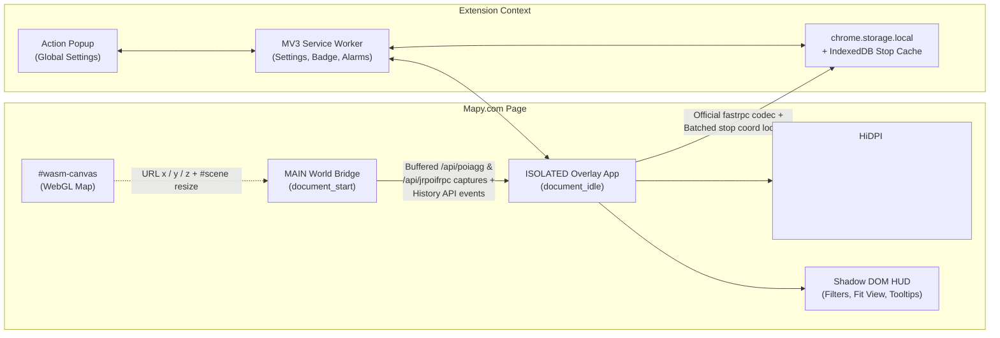

# Mapy.com Transit Connections Mapper

A Chromium Manifest V3 browser extension for **Google Chrome** and **Microsoft Edge** that maps all public transport routes, downstream stops, and travel times for the currently selected transit stop directly onto [Mapy.com](https://mapy.com)’s map view.

---

## Features

- **Full Route Visualization:** Automatically maps every public transport line departing from the selected stop—including nearby/opposite-direction platforms—directly onto Mapy.com’s map canvas.
- **Fit All Connections:** One-click button smoothly zooms and pans the map to frame all reachable stops without reloading the page or losing Mapy.com’s sidebar state.
- **Interactive Exploration:** Hover any route or stop node for line number, destination, fare zone, travel time (`+N min`), and next departures; click any downstream stop to jump directly to it and continue exploring transfers.
- **Travel-Time Isochrone Mode:** Optionally color-code stops by travel time (`≤ 10 min` green, `11–25 min` amber, `> 25 min` red) and filter reachable stops with a max-minutes slider.
- **Fast & Local Caching:** Reuses Mapy.com’s own FastRPC responses and caches resolved stop coordinates locally in IndexedDB (30-day TTL). No external servers, no API keys, and zero telemetry.

---

## User Guide

### 1. Build & Install (Chrome or Edge)

**Prerequisites:** Node.js 20+ and npm.

```bash
git clone git@github.com:vkotek/mapy-transit-mapper.git
cd mapy-transit-mapper
npm install
npm run build
```

Load the compiled `dist/` folder as an unpacked extension:

1. Open `edge://extensions` (Microsoft Edge) or `chrome://extensions` (Google Chrome).
2. Enable **Developer mode**.
3. Click **Load unpacked** and select the `dist/` directory inside this repository.

### 2. Using the Extension on Mapy.com

1. **Select any public transport stop** on [mapy.com](https://mapy.com) (URLs with `source=pubt&id=...`, e.g., a bus, tram, metro, or train stop).
2. A compact floating **Transit HUD** appears in the top-left corner of the map showing the stop name, line count, and resolved stop count (e.g., `3 line(s) • 28/28 stops`).
3. **Fit all connections:** Click **Fit all connections** to smoothly zoom out from street level so the entire network of lines serving that stop fits in view.
4. **Filter & highlight lines:**
   - Click any line row in the HUD (e.g., `628`, `621`) to toggle its visibility on the map.
   - Hover a line in the HUD or in Mapy.com’s sidebar/timetable to highlight that route and dim others.
   - Toggle **Nearby** to show or hide dashed lines departing from adjacent/opposite-direction platforms.
   - Toggle **Labels** to show or hide stop name pills.
   - Toggle **Travel time** to switch stop dots to travel-time coloring and reveal the **Max minutes** filter slider.
5. **Inspect & hop between stops:**
   - Hover any stop node or route segment on the map to view a tooltip with stop name, line, destination, fare zone, `+N min` travel time, and upcoming departures.
   - Click any mapped stop node to navigate Mapy.com to that stop and immediately map its outgoing connections.
6. **Extension Toolbar Popup:** Click the extension icon in your browser toolbar to globally enable/disable the overlay, toggle curved vs. straight route lines, adjust default visual options, or clear the local stop coordinate cache.

> **Note on 3D / Rotated Map Views:** The 2D Web Mercator overlay requires Mapy.com’s standard 2D north-up view. If 3D tilt or map rotation is active, the HUD displays a reminder to switch back to 2D view for exact alignment.

---

## Solution Architecture

Mapy.com renders its map inside an opaque custom **WASM/WebGL** canvas (`#wasm-canvas` inside `#scene`) rather than Leaflet or MapLibre, and serves transit/POI data over Seznam’s binary **FastRPC** protocol (`application/x-frpc`). The extension works cleanly within these constraints using a two-world Manifest V3 architecture:



### 1. Two-World Content Script Bridge
- **`MAIN` world (`src/content/main-world-bridge.ts`, `run_at: "document_start"`):**
  - Non-destructively wraps `window.fetch` and `XMLHttpRequest` to passively capture `/api/poiagg` and `/api/jrpoifrpc/` responses without duplicating requests.
  - Buffers early captures that complete before `document_idle` and replays them once the `ISOLATED` script sends a `BRIDGE_READY` handshake.
  - Hooks `history.pushState`, `history.replaceState`, and `popstate` to broadcast live URL and viewport (`x`, `y`, `z`, `source`, `id`, `timeboard`) changes via `window.postMessage`.
- **`ISOLATED` world (`src/content/overlay-app.ts`, `run_at: "document_idle"`):**
  - Runs in the isolated extension world with access to `chrome.*` APIs, orchestrating data fetching, canvas rendering, hit-testing, and HUD updates.

### 2. Transit Data & FastRPC Pipeline
- **FastRPC Serialization (`src/content/frpc-codec.ts`):** Uses Seznam’s official `fastrpc` library (`parse` / `serializeCall`) for exact wire compatibility with Mapy.com’s binary `application/x-frpc` endpoints.
- **Route & Stop Discovery (`src/content/transit-data.ts`):**
  1. Reads `poi.extend.transportlines` and `poi.extend.signs` from `/api/poiagg` (`detail("pubt", stopId, ...)`) to discover all lines, directions, and platform IDs serving the selected stop.
  2. Queries `/api/jrpoifrpc/` (`sheetIntervals(signId, lineId, direction, { lang: ["en"] })`) for every discovered line to obtain the complete ordered `stopList` (stop IDs, names, fare zones, and travel times)—even when `#timeboard` is closed.
  3. Deduplicates all downstream stop IDs, checks IndexedDB (`src/content/stop-cache.ts`, 30-day TTL), and resolves only uncached stops via throttled `/api/poiagg` `detail` batches (concurrency 6), rendering lines progressively as coordinates arrive.
  4. Mirrors Mapy.com’s `.content-transportlines` and `#timeboard table.line` DOM as a live supplement (capturing exact minute offsets and sidebar hover sync).

### 3. Map Projection & Overlay Rendering
- **Web Mercator Calibration (`src/content/map-projection.ts`):** Uses standard **256px Web Mercator** tile math (`worldSize = 256 * 2^z`), verified directly against Mapy.com’s `.control-scale` bar and `#scene` center `(x, y, z)`.
- **Synchronized Canvas (`src/content/canvas-renderer.ts`):**
  - Mounts a transparent HiDPI `<canvas>` inside `#scene` directly above `#wasm` and below `#all-controls` (`pointer-events: none`), keeping all native Mapy.com controls interactive.
  - Uses `ResizeObserver` on `#scene` to react immediately to sidebar/timeboard resizing, plus live pointer-drag offset interpolation between `history.replaceState` commits to eliminate lag during panning.
  - Performs lightweight spatial hit-testing on stop nodes and line segments for tooltips and click-to-navigate.
- **Shadow DOM UI (`src/content/hud-ui.ts`):** Encapsulates all HUD controls and tooltips inside an open Shadow Root so Mapy.com styles never leak into the extension UI (and vice versa).
- **SPA Fit View:** **Fit all connections** computes the bounding box of all visible resolved stops and updates Mapy.com’s viewport via `history.pushState` + `PopStateEvent('popstate')`, avoiding full page reloads.

### 4. Repository Structure

| Path | Responsibility |
| :--- | :--- |
| `manifest.json` | Manifest V3 declaration (Chrome & Edge) |
| `src/content/main-world-bridge.ts` | `MAIN` world `fetch`/`XHR` & History API tap with early-load buffer |
| `src/content/overlay-app.ts` | `ISOLATED` world orchestrator, self-healing mount, pointer events & sidebar sync |
| `src/content/frpc-codec.ts` | Official Seznam `fastrpc` wrapper and recursive coordinate extractor |
| `src/content/transit-data.ts` | Transit line/stop discovery (`detail` + `sheetIntervals`), batching & DOM fallback |
| `src/content/stop-cache.ts` | IndexedDB cache (`pubtId → { lat, lon, name }`) with 30-day TTL |
| `src/content/map-projection.ts` | 256px Web Mercator projection, URL parser, and bounding-box fit math |
| `src/content/canvas-renderer.ts` | HiDPI 2D canvas renderer (polylines, chevrons, stop nodes, labels, hit-testing) |
| `src/content/hud-ui.ts` | Shadow DOM floating control panel and hover tooltips |
| `src/background/service-worker.ts` | Stateless MV3 service worker (settings, toolbar badge count, cleanup alarm) |
| `src/popup/` | Extension toolbar popup (`popup.html`, `popup.css`, `popup.ts`) |
| `scripts/generate-icons.mjs` | Pure-Node PNG icon generator (`16`, `48`, `128px`) |
| `scripts/test-live-extension.mjs` | Headless Edge/Playwright live verification script |
| `tests/` | Vitest unit tests for FastRPC codec and Web Mercator projection |

---

## Permissions & Privacy

- **`storage` & `alarms`:** Persist user display preferences and schedule periodic cache maintenance.
- **`host_permissions` (`https://mapy.com/*`, `https://mapy.cz/*`):** Strictly scoped to Mapy.com domains; no access to any other websites.
- **Zero external traffic:** All network calls go exclusively to `mapy.com` using the browser’s existing session. No analytics, tracking, or third-party servers are used.

---

## Development & Testing

```bash
npm run typecheck   # Run TypeScript compiler check (tsc --noEmit)
npm test            # Run Vitest unit tests (FastRPC codec & map projection)
npm run build       # Generate icons and bundle all MV3 targets into dist/
```
